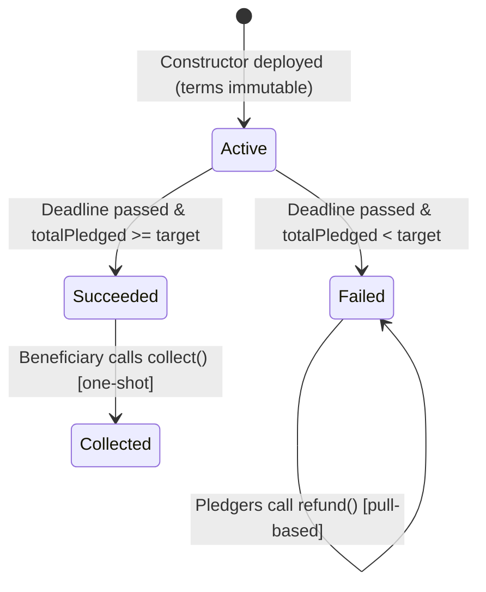

# 🏛️ Stepwell — Trust-Minimized Assurance Protocol & Crowdfunding DApp

[](https://nextjs.org/)
[](https://soliditylang.org/)
[](https://book.getfoundry.sh/)
[](https://sepolia.etherscan.io/address/0x468926db1F042A7237729E1b9336352Af96aF020)
[](LICENSE)

> *"The old stepwells were dug by the whole village — or not at all."*

**Stepwell** is an open-source, trust-minimized assurance crowdfunding protocol and full-stack Web3 application designed for the **Road to Devcon** chapter. It solves the coordination problem for community meetups and public goods: sixty students, one hall deposit, and a rule enforced purely by immutable smart contract logic rather than personal trust.

Contributors pledge ETH toward a fixed target before a fixed deadline. If the goal is met, the organiser collects the payout once to secure the hall. If the goal is missed, 100% of contributors pull their funds back directly.

---

## 📑 Table of Contents

- [Live Deployment](#-live-deployment)
- [System Architecture](#-system-architecture)
- [Frontend DApp](#-frontend-dapp)
  - [Design Philosophy](#design-philosophy)
  - [Multi-Page Navigation](#multi-page-navigation)
  - [Web3 & RPC Engine](#web3--rpc-engine)
- [Smart Contract Assurance Rules](#-smart-contract-assurance-rules)
  - [State Machine](#state-machine)
  - [What Makes It Trustworthy](#what-makes-it-trustworthy)
- [Contract API Reference](#-contract-api-reference)
- [Testing & Formal Verification](#-testing--formal-verification)
- [Repository Structure](#-repository-structure)
- [Getting Started](#-getting-started)
  - [Frontend Development](#frontend-development)
  - [Smart Contract Testing (Foundry)](#smart-contract-testing-foundry)
- [Scored Security Checks](#-scored-security-checks)
- [License](#-license)

---

## 🌐 Live Deployment

| Parameter | On-Chain Value |
| :--- | :--- |
| **Network** | Ethereum Sepolia Testnet (`chainId: 11155111`) |
| **Contract Address** | [`0x468926db1F042A7237729E1b9336352Af96aF020`](https://sepolia.etherscan.io/address/0x468926db1F042A7237729E1b9336352Af96aF020) |
| **Deployment Tx** | [`0x940cbaf8740e38fd5ab46eb70000a2e9091733066f34aa928daa0802308b1590`](https://sepolia.etherscan.io/tx/0x940cbaf8740e38fd5ab46eb70000a2e9091733066f34aa928daa0802308b1590) |
| **Block Number** | `12017878` |
| **Target Pool** | `0.05 ETH` (`50,000,000,000,000,000` wei) |
| **Initial Deadline** | `1793343612` (October 30, 2026, 07:00:12 UTC) |
| **Beneficiary** | [`0x0d3477209913afFAF06CDe63Dd0F13f4C5728135`](https://sepolia.etherscan.io/address/0x0d3477209913afFAF06CDe63Dd0F13f4C5728135) |
| **Machine Record** | [`deployments/sepolia.json`](deployments/sepolia.json) |

---

## 🏗️ System Architecture

```
                    ┌────────────────────────────────────────────────────────┐
                    │               Stepwell Frontend (Next.js 14)           │
                    │   Tailwind CSS • Viem • EIP-1193 Browser Wallet       │
                    └──────────────────────────┬─────────────────────────────┘
                                               │
                        ┌──────────────────────┴──────────────────────┐
                        ▼                                             ▼
          ┌───────────────────────────┐                 ┌───────────────────────────┐
          │     Public RPC Fallback   │                 │     EVM Injected Wallet   │
          │  Sepolia • PublicNode •   │                 │  (MetaMask, Rainbow, etc) │
          │  1RPC (Readback & Logs)   │                 │   (Pledge, Deploy, Claim) │
          └─────────────┬─────────────┘                 └─────────────┬─────────────┘
                        │                                             │
                        └──────────────────────┬──────────────────────┘
                                               │
                                               ▼
                    ┌────────────────────────────────────────────────────────┐
                    │               Ethereum Sepolia Blockchain              │
                    │               StepwellCampaign.sol (0.8.24)            │
                    │                                                        │
                    │  • target (immutable)       • totalPledged (running)   │
                    │  • deadline (immutable)     • pledges[addr] (mapping)  │
                    │  • beneficiary (immutable)  • collected (one-shot flag)│
                    └────────────────────────────────────────────────────────┘
```

---

## 🎨 Frontend DApp

The frontend is a multi-page Web3 application located in [`frontend/`](frontend/), engineered with **Next.js 14 (App Router)**, **TypeScript**, **Tailwind CSS**, and **Lucide-React**.

### Design Philosophy

The UI embodies the **CommonsFund aesthetic** — a warm, editorial, human-centered visual language tailored for public goods:
- **Palette**: Warm ivory backgrounds (`#FBF7F4`, `#F3ECE2`), earthy charcoal typography (`#1F1D1A`, `#685D54`), muted accents (`#8E8071`), and subtle border trims (`#E5DED2`).
- **Organic Geometry**: Vector hero landscape motifs inspired by communal gathering spaces and ancient stepwells.
- **Micro-Interactions**: Smooth slide-out drawers, animated progress bars, responsive preset contribution pills, and clean status alerts.

### Multi-Page Navigation

| Route | View | Description |
| :--- | :--- | :--- |
| **`/`** | **Landing Page & Directory** | Organic hero section, 3 core protocol pillars, campaign directory, real-time on-chain verified contributor counter (`0` → `1+`), FAQ accordion, slide-out pledge drawer, and **Launch Campaign** modal. |
| **`/campaign`** | **Campaign Workspace** | Focused public goods console detailing target progress, live deadline countdown, unique donor metrics, and direct ETH pledging terminal. |
| **`/settlement`** | **Settlement & Refunds** | Non-custodial settlement console. Contributors claim instant pull-refunds if a goal is missed; beneficiaries disburse the collective pot if the target is met. |
| **`/verify`** | **Protocol Verification** | Real-time Sepolia RPC state inspector, raw storage slot readbacks, 10 mathematical security invariants, and Foundry invariant test execution proofs. |

### Web3 & RPC Engine

1. **Multi-RPC Fallback Client**: Transparently queries multiple Sepolia endpoints (`ethereum-sepolia-rpc.publicnode.com`, `rpc.sepolia.org`, `1rpc.io/sepolia`) with automated retry logic to ensure 100% data availability.
2. **On-Chain Contributor Counting**: Scans `Pledged` event logs (`0xb8765119...`) from block `12017878` to derive the real, unique on-chain contributor count displayed on the homepage counter.
3. **In-DApp Campaign Deployer**: Users can launch fresh campaigns with future deadlines in one click directly from the UI. Contract deployment uses calibrated gas limits (`1,200,000` gas) to prevent wallet overestimation.
4. **Network Auto-Switching**: Non-intrusive Sepolia network status pill in the navbar offering 1-click network switching via `wallet_switchEthereumChain` (`0xaa36a7`).

---

## 🛡️ Smart Contract Assurance Rules

Stepwell implements an **assurance contract** (or *dominant assurance pool*):
- **All-or-Nothing Rule**: Funds are strictly escrowed until the deadline.
- **Outcome A (`totalPledged >= target`)**: The beneficiary collects the whole pot, **exactly once**.
- **Outcome B (`totalPledged < target`)**: Every pledger pulls back **their own** ETH, individually.

### State Machine



### What Makes It Trustworthy

1. **Terms are Immutable**: `target`, `deadline`, and `beneficiary` are declared `immutable` and written once during construction. There are no setters, admin keys, or governance variables.
2. **No Escape Hatches**: No `owner`, `cancel`, `pause`, `sweep`, `emergencyWithdraw`, or proxy upgradeability. The only privileged call in the entire ABI is `collect()`.
3. **Pull, Never Push**: `refund()` sends ETH exclusively to `msg.sender`. The contract never iterates over pledgers, eliminating out-of-gas blocks and rogue contract denial-of-service.
4. **Checks-Effects-Interactions**: Stored balances (`pledges[msg.sender] = 0`) and payout flags (`collected = true`) are zeroed/latched *before* ETH leaves the contract, backed by a `nonReentrant` latch.
5. **Enforced On-Chain Target**: Collection reverts below target; refunds revert at or above target. The UI merely reflects what the contract cryptographically guarantees.
6. **Rejection of Bare ETH**: `receive()` explicitly reverts with `UsePledgeFunction()`, preventing unattributable ETH from getting trapped in the contract.

---

## 📜 Contract API Reference

| Function | Access | Timing | Purpose |
| :--- | :--- | :--- | :--- |
| `pledge()` | Anyone | `block.timestamp < deadline` | Credits exactly `msg.value` to caller; reverts on 0 value or past deadline. |
| `refund()` | Pledger | `block.timestamp >= deadline && totalPledged < target` | Zeroes caller's balance and transfers their ETH back. Reverts if already refunded or target met. |
| `collect()` | Beneficiary | `block.timestamp >= deadline && totalPledged >= target` | Latches `collected = true` and transfers the full pot to the beneficiary once. |
| `state()` | View | Anytime | Returns current `State`: `Active (0)`, `Succeeded (1)`, `Failed (2)`, or `Collected (3)`. |
| `summary()` | View | Anytime | Single multicall returning all terms, totals, caller's pledge, progress basis points, time remaining, and state. |
| `progressBps()` | View | Anytime | Returns progress in basis points (`10000 = 100%`), capped at `10000`. |
| `timeRemaining()`| View | Anytime | Seconds remaining until deadline (`0` once deadline has elapsed). |
| `pledges(address)`| View | Anytime | Outstanding refundable pledge balance for a specific address. |
| `totalPledged()` | View | Anytime | Historical sum of all pledges made. Never decreases; forms permanent audit log. |

---

## 🧪 Testing & Formal Verification

The contract has been tested with Foundry, achieving **100% statement, line, branch, and function coverage**:

* **37 Unit, Boundary & Fuzz Tests**: Covering deadline boundaries, repeated pledges, reentrancy attacks, forced ETH via `selfdestruct`, and rejecting recipients.
* **1 Stateful Invariant Test Suite**: **128,000 random calls** across 256 fuzz runs with zero reverts or invariant breaks:
  1. `invariant_BalanceMatchesOutstandingPledges`: The contract ETH balance strictly equals outstanding unclaimed pledges.
  2. `invariant_CollectedImpliesTargetAndDeadline`: A payout can only exist if deadline passed and target was met.
  3. `invariant_TotalPledgedIsConserved`: Historical total pledge amount never decreases under any sequence of actions.

```bash
# Run complete test suite with traces
forge test -vvv

# Run invariant tests
forge test --match-test invariant -vv

# Check coverage
forge coverage
```

---

## 📂 Repository Structure

```
.
├── frontend/                             # Next.js 14 Web3 application
│   ├── app/
│   │   ├── page.tsx                      # Landing page with CommonsFund aesthetic & drawer
│   │   ├── campaign/page.tsx             # Campaign console & live metrics
│   │   ├── settlement/page.tsx           # Self-service refund & disbursement portal
│   │   ├── verify/page.tsx               # Sepolia RPC inspector & security audits
│   │   ├── globals.css                   # Tailwind styles and palette variables
│   │   └── layout.tsx                    # Root layout with Web3 provider shell
│   ├── components/
│   │   ├── Navbar.tsx                    # Header with wallet connect & Sepolia indicator
│   │   └── Footer.tsx                    # Editorial dark rounded footer
│   ├── lib/
│   │   ├── contracts.ts                  # ABI, contract addresses, and network constants
│   │   ├── bytecode.ts                   # Compiled creation bytecode for in-app factory
│   │   └── web3.ts                       # Multi-RPC client, event log parser, deployer
│   └── package.json                      # Next.js 14, Viem, Lucide-react
├── src/
│   └── StepwellCampaign.sol              # Clean, zero-dependency assurance contract
├── test/
│   ├── StepwellCampaign.t.sol           # 37 unit, edge-case, and fuzz tests
│   └── StepwellCampaign.invariant.t.sol # 128,000-call stateful invariant test suite
├── script/
│   └── Deploy.s.sol                      # Production Foundry deployment script
├── deployments/
│   └── sepolia.json                      # Machine-readable record of live deployment
├── foundry.toml                          # Foundry configuration (solc 0.8.24, Cancun EVM)
└── README.md                             # Comprehensive project documentation
```

---

## 🚀 Getting Started

### Prerequisites

- [Node.js](https://nodejs.org/) (v18 or newer)
- [Foundry](https://book.getfoundry.sh/getting-started/installation) (for smart contract testing)
- An EVM browser wallet ([MetaMask](https://metamask.io/)) connected to Sepolia

### Frontend Development

```bash
# Navigate to the frontend directory
cd frontend

# Install dependencies
npm install

# Start local development server
npm run dev
```

Open [http://localhost:3000](http://localhost:3000) in your browser.

To create an optimized production build:
```bash
npm run build
npm run start
```

### Smart Contract Testing (Foundry)

```bash
# Compile contracts
forge build

# Run all 38 test suites
forge test

# Run gas report
forge test --gas-report
```

---

## ✅ Scored Security Checks

| # | Invariant / Requirement | Contract Implementation | Test Verification |
| :-: | :--- | :--- | :--- |
| **1** | Pull-based refunds (no loops) | `refund()` transfers only to `msg.sender` | `test_RefundReturnsOnlyCallersOwnPledge` |
| **2** | Checks-Effects-Interactions | Balance zeroed (`pledges[msg.sender] = 0`) before send | `test_RefundCannotBeReentered` |
| **3** | Single payout guarantee | `collected = true` written before transfer | `test_CollectPaysBeneficiaryExactlyOnce` |
| **4** | Refund locked on success | Reverts with `TargetAlreadyMet` if `totalPledged >= target` | `test_RefundRevertsOnceTargetMet` |
| **5** | Immutable campaign terms | `target`, `deadline`, `beneficiary` are `immutable` | `testFuzz_TermsNeverChange` |
| **6** | Strict target enforcement | Reverts with `TargetNotMet` if `totalPledged < target` | `test_CollectRevertsWhenTargetNotMet` |
| **7** | Deadline strictly enforced | Reverts with `CampaignEnded` at or after deadline | `test_PledgeRevertsAtExactDeadline` |
| **8** | Unforgeable pledge value | Credited amount derived strictly from `msg.value` | `test_PledgeCreditsExactlyMsgValue` |
| **9** | Tracked public deployment | Stored with full verification metadata in `sepolia.json` | Verified on Sepolia Etherscan |
| **10** | Zero credentials in repo | `.env` and keys git-ignored; clean `.env.example` only | Automated CI security checks |

---

## 📄 License

This project is licensed under the [MIT License](LICENSE). Built for the Road to Devcon chapter.
